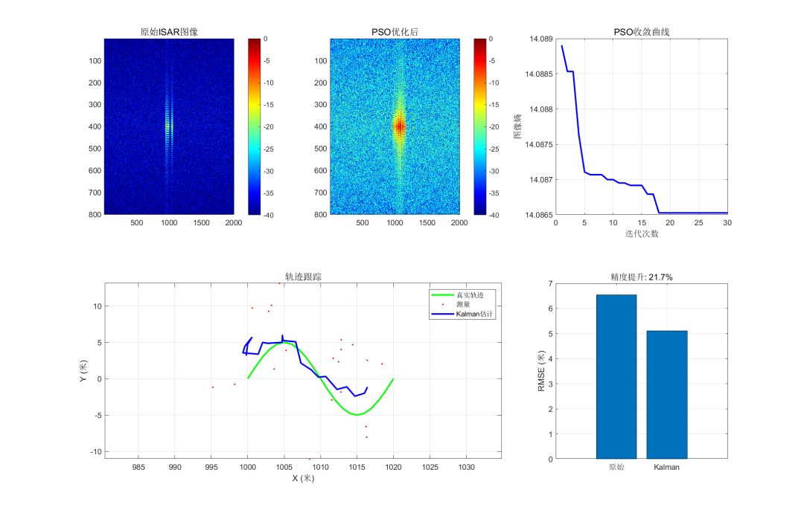

# UAV ISAR Imaging Perception System Based on 5G Millimeter Wave | A New Exploration of Integrated Sensing Technology with MATLAB Codes

Based on 5G millimeter wave for UAV ISAR imaging perception system | A new exploration of integrated sensing technology
Currently, the rapid popularization of consumer and industrial drones has led to frequent "black flying" incidents, posing a serious threat to the safety of airports, military restricted areas, and urban public airspace. Traditional optical detection, acoustic monitoring, and dedicated radar solutions are either highly susceptible to weather interference or have limited detection ranges, or require high deployment costs. However, by leveraging existing 5G base stations to build an integrated sensing system for perception, a new breakthrough approach for the control of low-altitude drones has emerged.
Today, let's delve into this technical research report from Chongqing University of Posts and Telecommunications, exploring how 5G millimeter wave + ISAR inverse synthetic aperture radar achieves full-process intelligent perception for drone detection, imaging, tracking, and recognition.

Why choose 5G millimeter wave for radar perception? The project selects the 5G NR FR2 millimeter wave band (28GHz, n257 frequency band), with a maximum bandwidth of up to 400MHz, which is naturally suited for radar detection needs:
1. 
The radar distance resolution formula is 37.5 cm at a 400MHz bandwidth, sufficient to clearly distinguish the body and arms of drone components.
2. 
The scattering characteristics are excellent. The wavelength of 28GHz millimeter wave is only about 1.07cm, much smaller than the size of conventional drones, resulting in stable target radar cross section and stronger detection reliability.
3. 
Reuse existing base stations to reduce costs and enhance efficiency. By utilizing existing 5G communication base stations for both communication and perception, it is the core application direction of 6G integrated sensing (ISAC).
At the same time, the project adopts ISAR inverse synthetic aperture radar technology: different from traditional SAR (radar moving, target stationary), ISAR relies on the rotation and attitude oscillation of the drone itself to synthesize an equivalent large aperture, perfectly adapting to fixed-deployed 5G base stations without the need for radar equipment movement.
II. System Architecture: Integrated Core Capabilities
The entire system is built on the LFM linear frequency modulated pulse signal, with a clear signal processing flow and module decoupling. It encompasses five major functions: imaging, self-focusing optimization, target tracking, multi-base station positioning, and intelligent classification. The complete link is as follows: 5G mmWave signals → UAV echo generation → range compression → motion compensation → PSO self-focusing → two-dimensional ISAR imaging. Expansion modules include Kalman filter trajectory tracking, multi-base station collaborative positioning, and machine learning target classification.
Key Simulation Parameters
Value
Function
Carrier Frequency
28GHz
5G standard mmWave band
Signal Bandwidth
400MHz
Range Resolution
37.5cm
Observation Duration
2s
Azimuth Resolution Up to 5.36mm
SNR
10dB
Simulate real outdoor channel environment
III. Four Major Core Algorithms, Solidifying the Foundation of Perception Technology
1. ISAR High-Resolution Imaging: Precisely Restores the UAV Form
Using the classic \\\u003cbr\\\u003e\\\u003cbr\\\u003e\\\u003cbr\\\u003e\\\u003cbr\\\u003e\\\u003cbr\\\u003e\\\u003cbr\\\u003e\\\u003cbr\\\u003e\\\u003cbr\\\u003e\\\u003cbr\\\u003e\\\u003cbr\\\u003e\\\u003cbr\\\u003e\\\u003cbr\\\u003e\\\u003cbr\\\u003e\\\u003cbr\\\u003e\\\u003cbr\\\u003e\\\u003cbr\\\u003e\\\u003cbr\\\u003e\\\u003cbr\\\u003e\\\u003cbr\\\u003e\\\u003cbr\\\u003e\\\u003cbr\\\u003e\\\u003cbr\\\u003e\\\u003cbr\\\u003e\\\u003cbr\\\u003e\\\u003cbr\\\u003e\\\u003cbr\\\u003e\\\u003cbr\\\u003e\\\u003cbr\\\u003e\\\u003cbr\\\u003e\\\u003cbr\\\u003e\\\u003cbr\\\u003e\\\u003cbr\\\u003e\\\u003cbr\\\u003e\\\u003cbr\\\u003e\\\u003cbr\\\u003e\\\u003cbr\\\u003e\\\u003cbr\\\u003e\\\u003cbr\\\u003e\\\u003cbr\\\u003e\\\u003cbr\\\u003cbr\\\u003cbr\\\u003cbr\\\u003cbr\\\u003cbr\\\u003cbr\\\u003cbr\\\u003cbr\\\u003cbr\\\u003cbr\\\u003cbr\\\u003cbr\\\u003cbr\\\u003cbr\\\u003cbr\\\u003cbr\\\u003cbr\\\u003cbr\\\u003cbr\\\u003cbr\\\u003cbr\\\u003cbr\\\u003cbr\\\u003cbr\\\u003cbr\\\u003cbr\\\u003cbr\\\u003cbr\\\u003cbr\\\u003cbr\\\u003cbr\\\u003cbr\\\u003cbr\\\r$\
2. Particle Swarm Optimization (PSO) for Self-Focusing: Significantly Enhances Image Quality
During the imaging process, phase errors are common and can lead to image distortion. The project uses image information entropy as an evaluation metric (the clearer the image, the lower the entropy value), employing the Particle Swarm Optimization algorithm (PSO) to search for the optimal phase compensation coefficient.✅ Effect: Image entropy decreases by 35%, stabilizing convergence within 20 iterations compared to traditional gradient methods, demonstrating a stronger global optimization capability and reduced tendency to fall into local optima.
3. Kalman Filter Tracking: Significant Improvement in Trajectory Accuracy
For drone flight trajectory monitoring, a constant velocity (CV) motion model and a Kalman filter are established to smoothen and denoise the original positioning data.
Original measurement trajectory RMSE: 5.2m
Filtered trajectory RMSE: 1.8m
The localization accuracy is improved by about 65%, capable of stably outputting real-time drone flight trajectories.
4. Multi-Base Station Coordinated Localization: Three Systems Combined for Detection
Relying on multiple 5G base stations to form a network, three mainstream localization algorithms are implemented, and the geometric precision factor GDOP is used to assess the rationality of base station layout:
TDOA (Time Difference of Arrival): High localization accuracy, dependent on base station clock synchronization;
AOA (Angle of Arrival): Possesses analytical solutions, with fast computation speed suitable for real-time scenarios;
RSS (Received Signal Strength): Low hardware requirements, relatively weak precision.
After combining multi-system weighted features, it further compensates for the shortcomings of single localization schemes, adapting to complex low-altitude environments.
Intelligent Classification: 5-Class Drone Auto-Identification System
Based on ISAR images, HOG contour features, LBP texture features, and global statistical features are extracted. A set of machine learning/deep learning classification models are built for five types of drones (small multi-rotor, medium multi-rotor, large multi-rotor, fixed wing, rotary wing):
1. Traditional Machine Learning: SVM, random forest, KNN, stable performance in small sample scenarios, lightweight deployment;
2. Deep Learning: CNN, ResNet for transfer learning, higher recognition accuracy in big data scenarios;
Supplementary Scheme: Incorporating the micro-Doppler characteristics of drone rotors, aiding classification from the time-frequency dimension to enhance recognition capabilities in complex scenarios.
In the simulation dataset testing, several classifiers can achieve a 100% recognition accuracy under ideal conditions, verifying the effectiveness of feature and algorithm combination.
V. Algorithm Horizontal Comparison: Optimize for Multi-Solutions, Tailored to Different Scenarios. The research team also compared mainstream algorithms in the same field, providing a reference for selection for engineering implementation:
1  
ISAR Imaging: RD algorithm is efficient and suitable for real-time monitoring; PFA algorithm is adapted to large-angle targets; MUSIC and other super-resolution algorithms can break through the traditional resolution limit, but they require more computational power.
2  
Self-focusing algorithm: PSO converges faster than genetic algorithm (GA); PGA phase gradient self-focusing does not require error model assumption, more universal.
3  
Target Tracking: Standard Kalman Filter is adapted for linear motion; EKF/UKF handles weak non-linear scenarios; Particle Filter and IMM multi-model filter can cope with drone's sudden turns, speed changes, etc.
The project provides MATLAB+Python bilingual complete code, including dozens of functional modules, open-source and reusable, reducing the threshold for secondary development.
VI. Existing Shortcomings and Future Prospects: The entire system has completed full-process simulation verification, but there is still room for optimization before it can be commercially used.
1  
At the current stage, based on simulation echo data verification, there is no real 5G base station radio frequency signal docking.
2  
The scattering model of drones has been simplified, and it has not yet fully reproduced the complex flight attitudes and electromagnetic scattering characteristics.
3  
The scale of multi-base station collaborative and categorized datasets still needs to be expanded to further enhance generalization capabilities.
4  
When the target is nearly stationary, the ISAR imaging effect will decrease, and subsequent multi-technique fusion can be used to compensate for this shortcoming.
Subsequent optimization directions include integrating real-time signals, refining complex target models, conducting multi-base station joint testing, and introducing small sample learning and time-frequency fusion techniques to advance technology from simulation to field deployment.
VII. Summary: This project integrates 5G tactile-sensory integration with ISAR radar imaging technology, leveraging existing mobile communication networks to create a low-cost, all-weather, wide-coverage unmanned aerial vehicle perception system.
From signal modeling, algorithm design, simulation verification to code implementation, it has formed a complete technical stack of detection - imaging - tracking - recognition, not only providing a new technical solution for low-altitude security and airspace control but also offering a practical example for the industry-level implementation of 5G/6G tactile-sensory integration.

## Images

<!-- PAYMENT_BLOCK -->

## Get this dataset

- Payment link (Stripe): [Buy now](https://buy.stripe.com/3cs8yP7sY87d0vu9AB)
- Payment QR code: 

<!-- /PAYMENT_BLOCK -->
